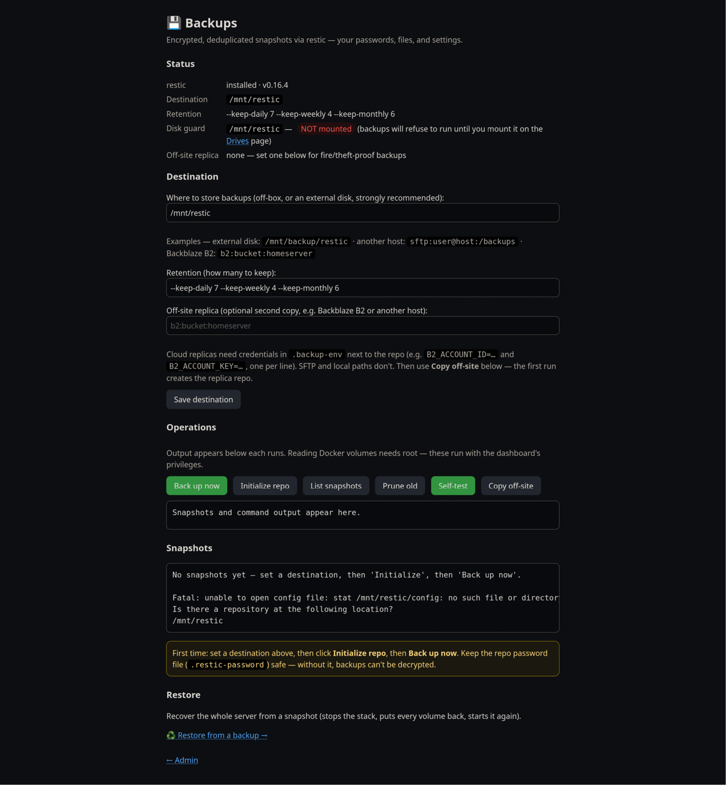

# Backup & restore

Backups are **encrypted** (restic: AES-256, client-side — the destination only ever sees
ciphertext) and cover a **consistent Postgres dump + a consistent Vaultwarden DB snapshot +
every data volume + your config**.

- [What gets backed up, and how](#what-gets-backed-up-and-how)
- [Choose a destination](#choose-a-destination)
- [Set it up and run](#set-it-up-and-run)
- [Check it actually works](#check-it-actually-works)
- [Schedule it nightly](#schedule-it-nightly)
- [Off-site replica](#off-site-replica)
- [Restore (disaster recovery)](#restore-disaster-recovery)
- [See a real restore, safely](#see-a-real-restore-safely)

All of this is also available without a terminal, from the dashboard's **Backups** page at
`/admin/backup`.



---

## What gets backed up, and how

Vaultwarden uses SQLite (WAL mode), so its DB can't be copied safely while live — `backup run`
briefly stops Vaultwarden (~1s) to copy its **SQLite fileset (`db.sqlite3` + `-wal` + `-shm`)**
into `backups/staging/vaultwarden/`, then restarts it; its attachments and keys are backed up
**live** with the volume. So the stop stays ~1s no matter how large attachments grow. (The
`-wal` is essential — `docker stop` may not checkpoint it, and dropping it would lose recent
writes.) Nextcloud is never stopped; its DB is dumped online with `pg_dump` — written to a
temporary file and only kept once `pg_dump` finished, so a snapshot never carries a truncated or
stale dump. A restore rebuilds Nextcloud's database from that dump (the raw database volume is
copied while Postgres runs, so it isn't guaranteed consistent).

Every snapshot also carries hsctl's config: each app's `.env`, `setup.conf`, `backup.conf`,
`.backup-env`, `.ui-password`, `pihole/custom.list` and `services.json` — everything a rebuild on
new hardware needs except `.restic-password` (keep that somewhere else — see below).

`backup run` needs `sudo` because it reads the Docker volume files, which are owned by root; run
without it, it refuses instead of saving a snapshot that's missing every file it couldn't read.
One state-changing hsctl operation runs at a time — a backup, a restore, a dashboard job or a
terminal command — so a backup can never read volumes a restore is wiping.

---

## Choose a destination

A backup on the same disk only protects against mistakes, not disk failure or theft. Point
it somewhere **off the box**:

| Destination | `--repo` value |
|-------------|----------------|
| External USB drive | `/mnt/restic` |
| Another machine (NAS, Pi) over SSH | `sftp:user@nas:/backups` |
| Cloud (S3-compatible) | `s3:s3.region.amazonaws.com/your-bucket` |

If the destination is on an external disk, the **disk guard** keeps a backup from silently
landing on the system disk when the disk isn't attached. A destination under `/mnt/…` or
`/media/…` gets it automatically (`/mnt/backup/restic` → guard `/mnt/backup`); set or change it
yourself with:

```bash
hsctl backup config --require-mount /mnt/backup     # --require-mount "" turns it off
```

With a guard set, every backup and restore operation refuses to run unless that path is on a
different disk from `/`, the homeserver folder and Docker's data — and `backup init` won't create
a repository on the system disk for an unmounted `/mnt/…` destination. The dashboard's **Drives**
page (`/admin/devices`) can mount the disk for you with one click; those mounts last until reboot,
so to mount at boot add an `/etc/fstab` line for the disk with the `nofail` option.

---

## Set it up and run

```bash
sudo apt install -y restic                       # restic >= 0.14 (the repo is format v2)
sudo apt-mark hold restic                        # pin it — apt upgrade won't change it
                                                 #   (undo later with: sudo apt-mark unhold restic)
hsctl backup config --repo /mnt/backup/restic    # set the destination (sets the disk guard too)
hsctl backup config --password 'StrongPassword'  # OPTIONAL: set your own repo password
                                                 #   (omit and init generates one)
sudo hsctl backup init                           # create the encrypted repo (first time only)
sudo hsctl backup run                            # take a snapshot
sudo hsctl backup list                           # see snapshots
sudo hsctl backup forget                         # apply the retention policy and prune
```

The repo password lives in **`.restic-password`** (set via `--password`, or generated by the
first `backup init`). Only `init` ever generates one: if the file goes missing later, `run`,
`restore` and the rest stop and tell you to put your saved password back
(`hsctl backup config --password '…'`) instead of quietly making a new one that can't open your
backups. `hsctl secrets show` prints it with the other logins. Full details — including changing
it later and restoring with plain restic (no hsctl) — are in
**[configuration.md → Backups](configuration.md#backups)**.

> **Back up `.restic-password` somewhere else** (e.g. write it down, or store it in
> Vaultwarden). It encrypts your backups — **without it, the backups are unrecoverable.**

Default retention is `--keep-daily 7 --keep-weekly 4 --keep-monthly 6`; change it with
`hsctl backup config --retention '…'` or the Backups page's daily/weekly/monthly boxes. Only
restic's `--keep-*` options (and `--group-by`) are accepted — anything else is refused, because
restic would read a stray word as a snapshot ID to delete. Snapshots are grouped by tag, so adding
an app or moving to a new machine doesn't start a group of snapshots that's never pruned.

---

## Check it actually works

<a id="pin-restic"></a>

```bash
sudo hsctl backup config --pin-restic   # once: record the known-good restic version
sudo hsctl backup verify                # aliases: selftest, test
```

A self-contained drill that **never touches your live stack or repo** — it spins up throwaway
Docker volumes/containers and an isolated temp repo. It runs five checks:

1. **restic round-trip** — token into a volume → backup → wipe → restore → read it back.
2. **`restore --into-volumes` put-back** — seeds a throwaway volume with stale data, runs the
   real put-back primitive, and confirms the stale data is **gone** and the snapshot's data is
   in place (so the destructive one-command restore can't silently leave old data behind).
3. **Vaultwarden (passwords)** — boots the real Vaultwarden image so it writes its SQLite DB,
   seeds a fake attachment, then runs the real path: stages the DB **fileset**, backs the volume up
   **live excluding the DB**, restores + overlays the fileset, confirms the DB is **byte-identical**,
   the **attachment survived** the live-volume path, and a fresh Vaultwarden **boots** and stays up.
4. **Vaultwarden WAL** — builds a SQLite DB with a row left **uncheckpointed in `-wal`** and proves
   the main file alone loses it but the `db.sqlite3` + `-wal` + `-shm` fileset preserves it
   (regression test for a real data-loss bug).
5. **Nextcloud database** — seeds a row in a throwaway Postgres, dumps it with the same
   `pg_dump` the backup uses, pushes it through restic, then imports into a **brand-new**
   Postgres and checks the row is back.

A check that can't run here (the stack isn't up, so the real images are unknown; `sqlite3`
isn't installed) is reported as **SKIPPED**, never counted as a pass.

It also enforces the **restic version pin**: `verify` fails if the installed restic differs
from the one recorded by `--pin-restic` (stored as `RESTIC_VERSION` in `backup.conf`), so a
system upgrade that swaps restic out is caught instead of silently changing your backup tool.
Safe to run anytime.

`verify` proves the backup *mechanism* on throwaway data. To check the backups you'd actually
restore from:

```bash
sudo hsctl backup check                         # restic check + re-read 5% of the stored data
sudo hsctl backup check --read-data-subset 100% # re-read all of it (slow)
```

---

## Schedule it nightly

`sudo hsctl install` — the same command that sets up the dashboard — also installs
`hsctl-backup.service` and `hsctl-backup.timer`, and switches the timer on as soon as a backup is
configured (`sudo hsctl backup init` switches it on if it wasn't yet). The timer runs at
**03:30 daily**, with `Persistent=true` so a missed run catches up after a reboot; if another
operation is running then, it waits up to 30 minutes for it.

Every run is recorded, whatever started it and however early it failed (disk not mounted,
password missing, another operation holding the lock). The dashboard shows how long ago the last
backup completed, flags it **overdue after 36 hours**, and shows the last failed attempt and its
error. To hear about a failure without opening the dashboard, give it a URL that gets a
plain-text POST — an [ntfy](https://ntfy.sh) topic, say:

```bash
hsctl backup config --notify-url https://ntfy.sh/your-secret-topic   # "" turns it off
```

---

## Off-site replica

A second copy, somewhere the house isn't — protection against fire and theft, not just disk
failure.

```bash
hsctl backup config --replica sftp:user@nas:/backups   # or s3:s3.region.amazonaws.com/bucket
sudo hsctl backup replicate                            # copy every snapshot to the replica now
```

- **Every backup copies itself to the replica** afterwards (nightly included), so it never quietly
  falls behind; `replicate` does it on demand. The Backups page shows when it last got a copy.
- The first copy **creates** the replica repo; later ones are incremental and deduplicated
  (`restic copy`), so only new data moves. If the replica exists but can't be opened (wrong
  password, host unreachable), you get that error — it's never re-initialized.
- The replica uses the **same encryption password** as the primary, so `.restic-password`
  restores from either.
- Retention is applied to the replica too, using the same `RETENTION` policy.
- The primary repo must be reachable — `replicate` copies *from* it.

**Cloud credentials** go in **`.backup-env`** next to `.restic-password`, one `KEY=VALUE` per
line, mode `0600` and git-ignored:

```bash
# .backup-env — S3-compatible storage
AWS_ACCESS_KEY_ID=…
AWS_SECRET_ACCESS_KEY=…
```

Local paths and `sftp:` destinations need no credentials file. SFTP authenticates with
**root's** SSH key and `known_hosts` — backups run as root, from the timer and the dashboard as
well as `sudo` — so set it up for root once: `sudo ssh-keygen` (if root has no key), copy
`/root/.ssh/id_*.pub` to the remote user's `authorized_keys`, then `sudo ssh user@nas` once to
accept the host key. There's no terminal to answer that prompt at 03:30.

There's a **Copy backups off-site** card on the dashboard's Command Center that runs the same
thing.

---

## Restore (disaster recovery)

**One command** restores the whole stack: it extracts the snapshot, checks it, stops
everything, repopulates every volume — Vaultwarden's database from its consistent staged copy,
Nextcloud's database rebuilt from its dump — and brings the stack back up.

```bash
sudo hsctl backup restore latest --into-volumes   # add --yes to skip the confirm prompt
```

It's destructive (it **wipes** each volume before restoring), so it confirms first, and it
refuses to run unless the backup disk is mounted (the `REQUIRE_MOUNT` guard). The snapshot is
checked **before** anything is stopped: one without volume data, or with Vaultwarden's files but
not its database, is refused and the running stack is left alone. Vaultwarden's staged database
is found wherever the repo lived when the backup was taken, so a restore onto a new machine or
a different folder works the same. If something fails part-way, it says exactly which volumes
were and weren't put back, and starts Caddy so the dashboard is reachable.

The snapshot is extracted to `backups/restore/` (git-ignored) and that plaintext copy is deleted
once it's back in the volumes.

There's a **Restore from a backup** flow on the dashboard too. It runs the same command as a
background job and follows its output; the restore restarts Caddy, so the page loses the server
for a few minutes — that's expected, it keeps checking and picks the output up again, and the
restore runs to the end even if you close the page.

<details>
<summary>Manual restore — if you'd rather inspect the files first or restore selectively</summary>

```bash
# 1. Extract a snapshot to an empty folder on a disk with room for it (not /tmp, which is often
#    RAM-backed). Latest, or a specific id from `backup list`.
sudo hsctl backup restore latest --target ~/restore

# 2. Stop the stack
hsctl down

# 3. Put each volume's files back (the restored tree mirrors the original paths). Empty each
#    volume first, or files deleted since the backup come back.
for d in ~/restore/var/lib/docker/volumes/*/; do
  v=$(basename "$d")
  sudo find "/var/lib/docker/volumes/$v/_data" -mindepth 1 -delete
  sudo cp -a "$d/_data/." "/var/lib/docker/volumes/$v/_data/"
done

# 3b. IMPORTANT: step 3 restored Vaultwarden's volume (attachments/keys) but NOT its db.sqlite3
#     (it's excluded from the volume backup). Overlay the consistent DB from staging, or you
#     lose your passwords. Its path inside the extraction is the repo's path at backup time:
sudo cp -a "$(sudo find ~/restore -type d -path '*backups/staging/vaultwarden')"/db.sqlite3* \
           /var/lib/docker/volumes/vaultwarden_vw-data/_data/

# 4. Start everything
hsctl up

# 5. Delete the extraction — it's a plaintext copy of every secret and database.
sudo rm -rf ~/restore
```
</details>

> The Nextcloud database volume in the snapshot was copied while Postgres ran; the consistent
> copy is the SQL dump next to Vaultwarden's staging folder (`…/backups/staging/nextcloud-db.sql`).
> `--into-volumes` rebuilds the database from it. By hand: after step 3, start only the database
> (`cd nextcloud && docker compose up -d db`), then
> `docker exec nextcloud-db psql -U nextcloud -d postgres -c 'DROP DATABASE nextcloud WITH (FORCE)'`,
> `… -c 'CREATE DATABASE nextcloud OWNER nextcloud'`, and
> `docker exec -i nextcloud-db psql -U nextcloud -d nextcloud < …/nextcloud-db.sql`.

On a brand-new machine, restore the config files too (the restored `<repo>/*/.env` and
`<repo>/setup.conf`) before `hsctl up`. The restic repo password must be the same one you
saved.

**You don't need hsctl at all to recover.** The repo is a vanilla restic repository — with
just the destination and the password you can decrypt and extract everything from any machine
that has the `restic` binary. Step-by-step:
[configuration.md → Manual disaster recovery](configuration.md#manual-disaster-recovery--plain-restic-no-hsctl).

---

## See a real restore, safely

`hsctl backup verify` is the automated pass/fail self-test on synthetic data. To instead
**see your real data come back** — restore an actual snapshot and log into the apps — without
risking the live stack, use the sandbox:

```bash
make sandbox REPO=/mnt/restic    # boot an isolated copy of the stack, real repo mounted read-only
make sandbox-restore             # restore latest into it, bring the stack up
```

The real repo is mounted **read-only** and read with `restic restore --no-lock`, so your live
backup is never written or even locked. Full details: **[sandbox/README.md](../sandbox/README.md)**.
